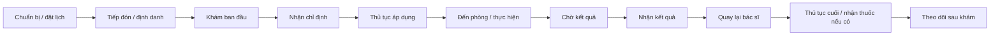
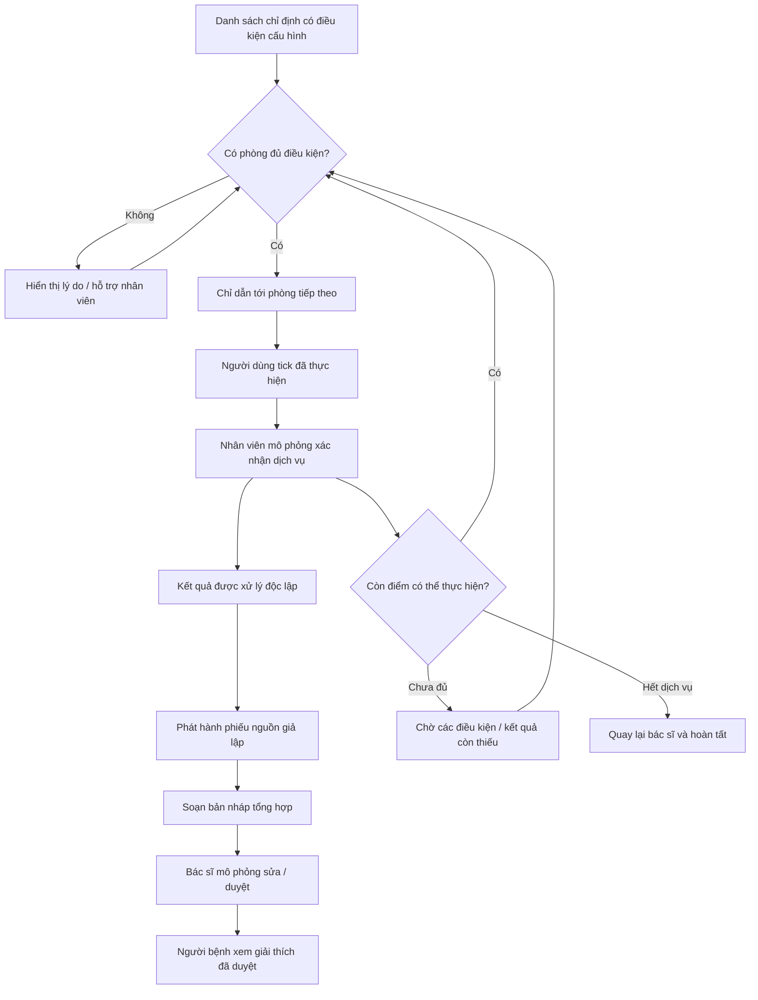

# Journey map — một lượt khám, nhiều chỉ định

**Trạng thái:** nghiên cứu bàn và giả thuyết ngày 17/10/2026, chưa xác thực qua P1–P3. P1–P3 chủ yếu cung cấp solution signals về siêu âm, hội chẩn và tham vấn từ xa; không dùng chúng làm bằng chứng cho pain H01–H04. Codex hỗ trợ tổng hợp. Đối tượng dự kiến: người trưởng thành khám ngoại trú, tự di chuyển giữa nhiều phòng, có lấy mẫu xét nghiệm và chẩn đoán hình ảnh theo chỉ định. Không mô hình hóa cấp cứu, nội trú hoặc thủ thuật có quy trình riêng.

Nguồn và giới hạn: [sổ nguồn V01–V04](../04-best-practice/sources.md). Các điểm đau/cảm xúc dưới đây là **giả thuyết**, không phải lời người bệnh hay kết quả khảo sát. Không dùng tên phòng hoặc thời gian demo như thông tin Vinmec thực tế.

## 1. Toàn hành trình tham chiếu

| Bước | Hành động / điểm chạm | Thông tin cần biết | Căn cứ và mức xác nhận | Điểm đau/cảm xúc giả định | Cách kiểm chứng |
| --- | --- | --- | --- | --- | --- |
| 1. Chuẩn bị, đặt lịch | Chọn cơ sở, lịch; nhận hướng dẫn | Giờ hẹn, nơi đến, việc cần chuẩn bị theo bệnh viện | V01 có đường đặt hẹn; chi tiết chuẩn bị tùy lượt khám, cần xác nhận | Lo không chuẩn bị đủ | P… kể lại trước lượt khám; tự dùng app |
| 2. Tiếp đón, hồ sơ, định danh | Quầy tiếp đón; tạo/đối chiếu hồ sơ | Hồ sơ nào, bước hành chính nào còn thiếu | V01 xác nhận tiếp đón, định danh | Bối rối về thủ tục | Hỏi bước thực tế, tránh thu thập giấy tờ cá nhân |
| 3. Khám ban đầu | Gặp nhân viên/bác sĩ theo lịch | Vị trí phòng và khi nào tới lượt | V04 đề cập chờ gặp bác sĩ; trình tự tổng hợp cần đối chiếu cơ sở | Chờ nhưng không rõ tiến độ | Phỏng vấn về thông tin chờ, không hỏi sức khỏe |
| 4. Nhận chỉ định | Nhận danh sách dịch vụ từ bác sĩ | Làm gì trước, ở đâu, điều kiện phụ thuộc | Bước tổng hợp để mô hình hóa lượt khám có chỉ định; V01 không mô tả đủ bước này | Danh sách khó chuyển thành lộ trình | Cho người tham gia kể lại cách biết nơi cần tới |
| 5. Hoàn tất thủ tục áp dụng | Thanh toán/bảo hiểm, đồng ý dịch vụ | Hạng mục nào đủ điều kiện thực hiện | V01 xác nhận có thủ tục; vị trí/thời điểm không cố định cho mọi lượt | Đi lại vì thiếu thủ tục | Đối chiếu quy trình cụ thể với nhân viên nếu có điều kiện |
| 6. Tới phòng và thực hiện | Đi theo biển/quầy; nhân viên xác nhận | Phòng/tầng, cách tới, trạng thái tiếp nhận | V01 xác nhận định danh trước can thiệp; đường đi/hàng đợi là phần cần khảo sát | H01: đi nhầm, hỏi lại | P… kể sự kiện cụ thể; test tìm điểm đến |
| 7. Chờ xử lý kết quả | Rời phòng thực hiện hoặc ở khu chờ | Đã làm xong chưa, kết quả đã có chưa, có thể đi tiếp không | V02/V03 mô tả nhận hồ sơ/kết quả; chưa xác nhận thời gian thực tại từng phòng | H02: ngồi chờ không cần thiết; sốt ruột | Hỏi từng trạng thái đã được thông báo thế nào |
| 8. Nhận kết quả | Hồ sơ MyVinmec/SMS hoặc kênh được hướng dẫn | Kết quả nào có, còn thiếu gì, đã được bác sĩ xem chưa | V02 cho hồ sơ tổng quát; V03 cho hình ảnh; không mặc định áp dụng đồng nhất | H03: khó hiểu trạng thái và thuật ngữ | Kiểm tra khả năng phân biệt phiếu nguồn và giải thích |
| 9. Quay lại bác sĩ | Nhận tư vấn kết quả | Phòng cần quay lại; các điều kiện đã đủ chưa | Bước tổng hợp cho kịch bản; vị trí và lịch phải xác nhận theo lượt khám | H04: không rõ phải quay lại khi nào | Hỏi bước sau nhận kết quả; test nhận biết điểm đến |
| 10. Kết thúc dịch vụ | Thủ tục còn lại; nhận thuốc nếu được chỉ định | Đã xong gì, còn việc hành chính nào | V01 có thanh toán; nhận thuốc chỉ là nhánh có điều kiện trong mô hình | Lo bỏ sót bước | Kiểm tra danh sách việc còn lại |
| 11. Sau khám | Xem lại hồ sơ, làm theo hướng dẫn/tái khám | Hồ sơ ở đâu, đầu mối hỗ trợ | V02 hỗ trợ xem lại hồ sơ; kế hoạch theo dõi theo bác sĩ | Quên hướng dẫn | Phỏng vấn trải nghiệm xem lại thông tin dịch vụ |

Đây là chuỗi tham chiếu đầy đủ về mặt phân tích, không phải SOP đã được Vinmec xác nhận. Không đồng nhất chờ bác sĩ trong V04 với chờ xét nghiệm.

## 2. Khoảnh khắc đào sâu — thực hiện, chờ, nhận và chuyển phòng

Điểm bắt đầu: có danh sách chỉ định đã được nhân viên xác định đủ điều kiện. Điểm kết thúc: các dịch vụ hoàn tất và người bệnh biết bước quay lại bác sĩ. Bước đặt lịch và nhận thuốc chỉ giữ làm bối cảnh.

| Mã | Sự kiện / điều người bệnh cần | Pain point giả định | Cảm xúc giả định | Cơ hội thử nghiệm | Bằng chứng cần có |
| --- | --- | --- | --- | --- | --- |
| PAIN-01 / H01 | Đọc danh sách rồi tìm đúng phòng | Không biết thứ tự, tầng hoặc đường đi | Bối rối | Một điểm đến rõ, chỉ dẫn từng bước | P…-Q… và T… tìm phòng |
| PAIN-02 / H02 | Đã lấy mẫu, muốn biết có thể rời đi không | Nhầm đã thực hiện với đã có kết quả; chờ tại chỗ | Sốt ruột, thiếu chủ động | Theo dõi hai trạng thái; đi tiếp khi được phép | Trích dẫn về lần chờ, đo hiểu trạng thái |
| PAIN-03 / H03 | Kết quả về lệch thứ tự | Không biết thiếu gì; đọc thông tin chưa được kiểm tra | Lo lắng | Phiếu gốc có nguồn, giải thích có nhãn duyệt | Test kết quả về không đúng thứ tự |
| PAIN-04 / H04 | Chuyển điểm tiếp theo / quay lại bác sĩ | Đi sai phòng hoặc bỏ sót bước | Không chắc chắn | Lộ trình cập nhật theo điều kiện | Test phòng đổi, phòng bận và bước bị chặn |

Không gán điểm cảm xúc số khi chưa hỏi người thật. Sau phỏng vấn, bổ sung lời nói nguyên văn, mã nguồn và bằng chứng trái chiều; điều chỉnh hoặc loại H01–H04 nếu không được hỗ trợ.

## 2b. Phân biệt problem discovery và solution discovery

P1–P3 mở ra ba hướng giải pháp có thể nghiên cứu tiếp: kiểm tra phép đo siêu âm, hỗ trợ hội chẩn và expert AI tham vấn từ xa. Các hướng này chưa thay đổi journey map người bệnh ngoại trú vì chưa có câu chuyện quá khứ về một pain cụ thể trong hành trình trên. Cần một vòng problem interview riêng để hỏi sự kiện, hành vi, workaround, tần suất và hậu quả trước khi đổi pain point hoặc need statement.

## 3. Workflow giải pháp để kiểm chứng

Các điều kiện do kịch bản/nhân viên cấu hình, không do AI suy luận. Việc mở phòng tiếp theo không phụ thuộc bản tóm tắt AI; bác sĩ vẫn có thể xem kết quả gốc khi AI lỗi.
